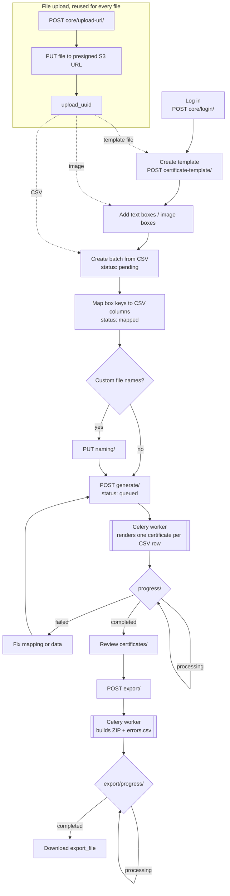

# Certifier Backend

Django + DRF API for certificate templates and batch certificate generation (rendered in Celery workers).

Frontend: [certifier_reloaded_frontend](https://github.com/Shantanu700/certifier_reloaded_frontend)

## Requirements

- Python 3.13 and [uv](https://docs.astral.sh/uv/)
- PostgreSQL
- Redis (Celery broker / result backend)
- S3-compatible bucket or Cloudinary account for file storage

## Setup

```bash
cp .env.sample .env        # then fill in values
uv sync
uv run manage.py makemigrations   # migrations are gitignored
uv run manage.py migrate
uv run manage.py createsuperuser
```

Django does not load `.env` on its own. Inside the devcontainer it comes from `docker/nonprod/docker-compose.yaml`; elsewhere, export it first (`set -a; source .env; set +a`).

## Run

```bash
uv run manage.py runsslserver 0.0.0.0:8001   # HTTPS; session cookies are Secure
uv run manage.py runserver 0.0.0.0:8000      # plain HTTP (login cookies won't stick)
uv run celery -A config worker -l info       # required for certificate generation
```

API docs: `/api/schema/swagger-ui/` and `/api/schema/redoc/`.

## Devcontainer

Open in VS Code and "Reopen in Container". The container joins the external `dev_db_network`, so create it and have Postgres running on it first:

```bash
docker network create dev_db_network
```

Ports: `8022` → 8000 (HTTP), `8033` → 8001 (HTTPS). The container idles; start the server yourself.

## Endpoints

| Prefix | Module |
|---|---|
| `core/` | auth (`core/login/`: Basic header; GET whoami, POST login, DELETE logout), presigned uploads (`core/upload-url/`) |
| `certificate-template/` | certificate templates |
| `certificate-batches/` | batch generation |
| `admin/` | Django admin |

## Workflow

All calls need a logged-in session (step 1). Every step's request/response shape is in Swagger.



1. **Log in**: `POST core/login/` with `Authorization: Basic base64(username:password)`.
2. **Upload a file**, used for templates, images and CSVs alike:
   1. `POST core/upload-url/` `{filename, content_type, category}` where `category` is `template` (png/jpg/pdf), `image_box` (png/jpg) or `csv_batch` (csv). It returns `{upload_uuid, url, headers}`.
   2. `PUT` the file bytes straight to `url` with `headers`.
   3. Pass `upload_uuid` as `upload` to the next call. The server checks that the file reached S3 and re-validates its type and size.
3. **Create a template**: `POST certificate-template/` `{name, upload}`.
4. **Place fields on it**:
   - Text: `POST certificate-template/<template>/boxes/` `{key, x, y, width, height, font?, font_size?, font_color?, alignment?}`
   - Images (logo, signature): `POST certificate-template/<template>/image-boxes/` `{key, x, y, width, height, upload}`
5. **Upload recipient data**: `POST certificate-template/<template>/batches/` `{upload}` with a CSV upload. The header row is stored as `csv_columns`, and the batch starts as `pending`.
6. **Map columns to boxes**: `PUT certificate-batches/<batch>/mapping/` `{mapping: {box_key: csv_column}}`. The batch moves to `mapped`.
7. **(Optional) Name output files**: `PUT certificate-batches/<batch>/naming/` `{naming_convention: [...]}`. Parts are `csv_key`, `sequence`, `random` and `fixed`. Send `null` to use the default name.
8. **Generate**: `POST certificate-batches/<batch>/generate/` queues a Celery job. Poll `GET certificate-batches/<batch>/progress/` until the status is `completed` or `failed`. Generation can be re-run from `mapped`, `completed` or `failed`.
9. **Review**: `GET certificate-batches/<batch>/certificates/` lists one certificate per CSV row, each with its file or `error_message`.
10. **Export a ZIP**: `POST certificate-batches/<batch>/export/`, then poll `GET certificate-batches/<batch>/export/progress/` until `export_file` is set. Failed rows are listed in `errors.csv` inside the ZIP.

Generation status: `pending → mapped → queued → processing → completed | failed`.

## Tests

```bash
uv run manage.py test
```

See [CLAUDE.md](CLAUDE.md) for architecture and conventions (`base/` framework, soft deletes, error shapes).
