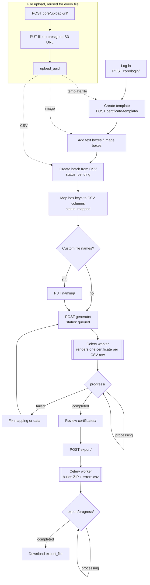

# Certifier Backend

Certifier lets an institution or event team design a certificate once, generate it for hundreds of people from a spreadsheet, issue each one to the right person's account, and let anyone check that a certificate is genuine.

This repo is the Django + DRF API (certificates render in Celery workers). The web app is [certifier_reloaded_frontend](https://github.com/Shantanu700/certifier_reloaded_frontend).

## Features

**Design templates**
- Upload a certificate design (PNG or JPG, up to 10 MB), or import a page straight from Canva at the resolution you choose. Refresh it from Canva later, and boxes you've placed are rescaled to fit.
- Place boxes on the design in a visual editor: text (three fonts, size, colour, alignment; long text shrinks to fit), images such as logos and signatures, QR codes, and a verification QR code and code that fill themselves in. Snap guides, arrow-key nudging and exact position fields help line things up.

**Generate in bulk**
- Upload a CSV of recipients, match its columns to the boxes, and choose how the files are named (CSV columns, fixed text, sequence numbers, random characters).
- Certificates render in the background with live progress. Review them, correct one certificate's text and re-make it, and download the lot as a zip, with a list of any rows that failed.
- Or issue a single certificate by hand, without a CSV.

**Issue to students**
- Match certificates to student accounts by email, roll number, date of birth, phone, institution or username (verified accounts only), or assign them one by one.
- Issue a whole batch at once. Revoke a batch, or a single certificate.

**For students**
- Sign up, verify their email and keep a profile.
- See and download every certificate issued to them. Revoked certificates stay listed, marked as revoked.

**Public verification**
- Each certificate can carry a code and a QR code. Anyone can check it at `/verify`, without signing in: it shows who it was issued to, by whom and when, or that it has been revoked.

**Accounts and security**
- Sign in with a username and password, or with Google. Issuers and students have separate roles.
- Rate limits on login, sign-up and verification.
- Light and dark themes.

**Not built yet:** emailing certificates to recipients.

## Quick start

With Docker, from the repo root:

```bash
docker compose up
```

That runs the API on <http://localhost:8000> with demo data: sign in through the [frontend](https://github.com/Shantanu700/certifier_reloaded_frontend) (with `NEXT_PUBLIC_API_URL=http://localhost:8000`) as `demo_issuer` or `student01`, password `demo-password`.

- **Developing:** [docs/development.md](docs/development.md) covers the Docker setup, running without Docker, the frontend, optional integrations (Google, Canva, email) and troubleshooting.
- **Running it for real:** [docs/self-hosting.md](docs/self-hosting.md) walks through a production deployment and ends with a checklist.

## Endpoints

| Prefix | Module |
|---|---|
| `core/` | auth (`core/login/`: Basic header; GET whoami, POST login, DELETE logout), presigned uploads (`core/upload-url/`) |
| `certificate-template/` | certificate templates |
| `certificate-batches/` | batch generation |
| `admin/` | Django admin |

## Workflow

All calls need a logged-in session (step 1). Every step's request/response shape is in Swagger.



1. **Log in**: `POST core/login/` with `Authorization: Basic base64(username:password)`.
2. **Upload a file**, used for templates, images and CSVs alike:
   1. `POST core/upload-url/` `{filename, content_type, category}` where `category` is `template` (png/jpg/pdf), `image_box` (png/jpg) or `csv_batch` (csv). It returns `{upload_uuid, url, headers}`.
   2. `PUT` the file bytes straight to `url` with `headers`.
   3. Pass `upload_uuid` as `upload` to the next call. The server checks that the file reached S3 and re-validates its type and size.
3. **Create a template**: `POST certificate-template/` `{name, upload}`.
4. **Place fields on it**:
   - Text: `POST certificate-template/<template>/boxes/` `{key, x, y, width, height, font?, font_size?, font_color?, alignment?}`
   - Images (logo, signature): `POST certificate-template/<template>/image-boxes/` `{key, x, y, width, height, upload}`
5. **Upload recipient data**: `POST certificate-template/<template>/batches/` `{upload}` with a CSV upload. The header row is stored as `csv_columns`, and the batch starts as `pending`.
6. **Map columns to boxes**: `PUT certificate-batches/<batch>/mapping/` `{mapping: {box_key: csv_column}}`. The batch moves to `mapped`.
7. **(Optional) Name output files**: `PUT certificate-batches/<batch>/naming/` `{naming_convention: [...]}`. Parts are `csv_key`, `sequence`, `random` and `fixed`. Send `null` to use the default name.
8. **Generate**: `POST certificate-batches/<batch>/generate/` queues a Celery job. Poll `GET certificate-batches/<batch>/progress/` until the status is `completed` or `failed`. Generation can be re-run from `mapped`, `completed` or `failed`.
9. **Review**: `GET certificate-batches/<batch>/certificates/` lists one certificate per CSV row, each with its file or `error_message`.
10. **Export a ZIP**: `POST certificate-batches/<batch>/export/`, then poll `GET certificate-batches/<batch>/export/progress/` until `export_file` is set. Failed rows are listed in `errors.csv` inside the ZIP.

Generation status: `pending → mapped → queued → processing → completed | failed`.

## Tests

CI runs ruff and these tests against Postgres on every pull request (`.github/workflows/ci.yml`).

```bash
uv run ruff check .
uv run manage.py test modules.core.tests modules.certificates.tests
# or, with the compose stack running:
docker compose exec web python manage.py test modules.core.tests modules.certificates.tests
```

See [CLAUDE.md](CLAUDE.md) for architecture and conventions (`base/` framework, soft deletes, error shapes).

## Contributing

Contributions are welcome: see [CONTRIBUTING.md](CONTRIBUTING.md). Commits need a DCO sign-off (`git commit -s`), and everyone taking part follows the [Code of Conduct](CODE_OF_CONDUCT.md). Report security problems privately, as described in [SECURITY.md](SECURITY.md).

## Licence

Copyright (C) 2026 Shantanu Gupta.

Certifier is free software: you can redistribute it and/or modify it under the terms of the [GNU Affero General Public License, version 3](LICENSE). If you run a modified version as a network service, the AGPL requires you to offer its users the source code of your version.
